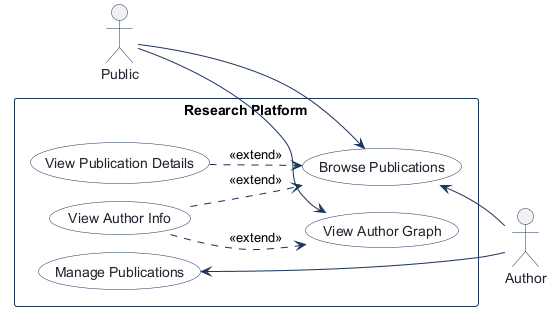
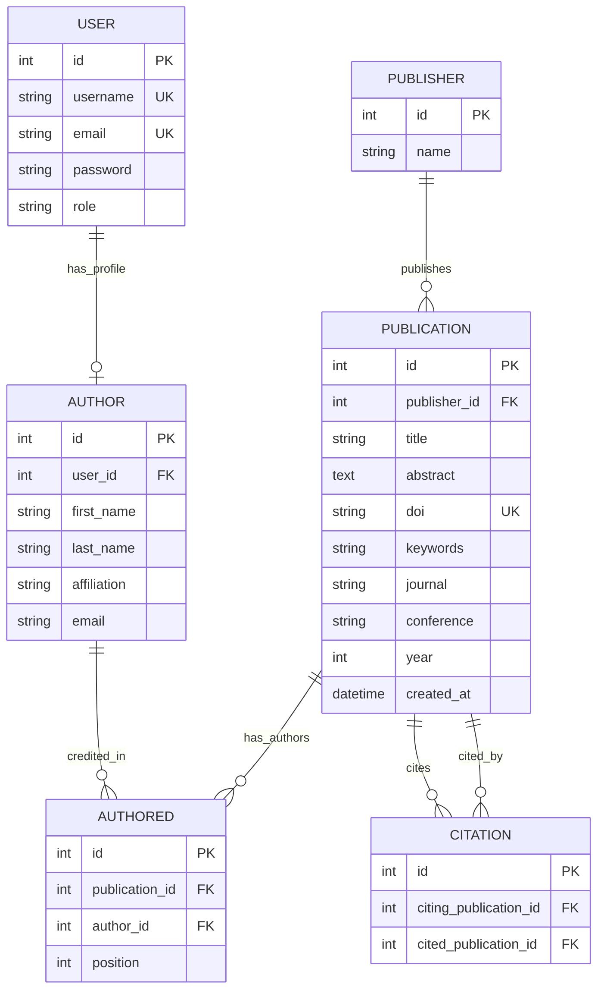
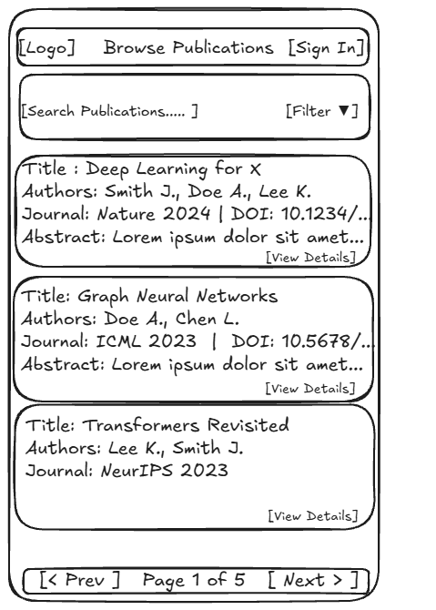
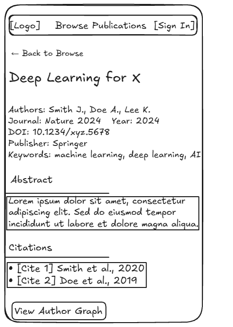
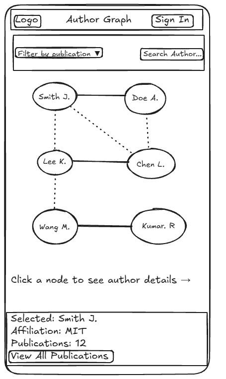
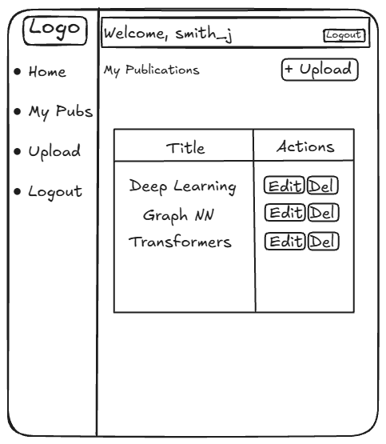

# COMP 3613 Assignment 1

Draft this file with the Guide. **Update it after every phase milestone** before you pause. The use-case diagram is a UML PNG at `docs/diagrams/use-case.png`, linked from this file as `diagrams/use-case.png` (path relative to `docs/report.md`). The model diagram is Mermaid. **Embed wireframe images** as `wireframes/<file>` (files live in `docs/wireframes/`).

Do not put your student ID in this file if you will commit it. The PDF cover adds your name and ID at export time.

## Assigned project

Research Platform

## Three workflows

### 1. Browse Publications (Public)

### 2. Manage Publications (Author)

### 3. View Author Graph (Public)

## Use case diagram

Browse Publications is shared by Public and Author. View Publication Details optionally extends Browse Publications. View Author Info optionally extends both Browse Publications and View Author Graph; the graph remains a separate public use case. Manage Publications remains an Author use case.

## Model diagram

Phase 5 implementation model. Datatypes and database constraints are now specified.

Relationship and business-rule notes:

- A `User` may have zero or one `Author` profile; each `Author` belongs to exactly one `User` (`Author.user_id` is unique).
- `Publisher` to `Publication` is one-to-many; each publication references one publisher.
- `Author` and `Publication` are many-to-many through `Authored`. Each author-publication pair is unique, and `position` records authorship order.
- Citations are directed publication pairs. A publication may cite many publications and be cited by many; each citing/cited pair is unique.
- `Publication.doi` is required and unique. `User.role` is limited to `public` or `author`.
- `Publication.publisher_id` is required. The upload wireframe marks title, abstract, DOI, publisher, journal, conference, year, and keywords as required; matching publication columns are non-null.
- `Author.user_id` is unique. `Publication.created_at` defaults to the current UTC time.
- `Authored.position` is 1-based, and Manage Publications requires at least one author.
- Only the first-listed author may edit or delete a publication. Reordering may transfer management rights to the new first-listed author after saving.
- Deleting a publication removes its authorship links and all incoming and outgoing citation links.

## Wireframes

### Browse Publications

### View Publication Details

### View Author Graph

### Manage Publications

<!-- student-build:wireframe-coverage
use_case: Browse Publications
image: docs/wireframes/browse-publications.png
covered: yes
-->

<!-- student-build:wireframe-coverage
use_case: View Publication Details
image: docs/wireframes/publication-details.png
covered: yes
-->

<!-- student-build:wireframe-coverage
use_case: View Author Graph
image: docs/wireframes/author-graph.png
covered: yes
-->

<!-- student-build:wireframe-coverage
use_case: Manage Publications
image: docs/wireframes/manage-publications.png
covered: yes
-->

Model notes from wireframe review:
- `Publication` and `Author` surfaces indicate metadata such as title, abstract, author list, and affiliation labels are visible in detail and graph views.
- `Manage Publications` includes a create/edit lifecycle. The accepted completion path is: after save, the user returns to the publications list where the new or edited record appears, with the list acting as the success confirmation state.
- No publication status was added because the wireframes do not show draft or published transitions.

## Theming

- Brand: ScholarNet, with a small academic-shield icon beside the wordmark.
- Colors: deep navy (`#1B365D`) primary, warm gold (`#C4A35A`) accent, and off-white (`#F7F4EF`) page backgrounds.
- Type: Fraunces serif headings and wordmark; Source Sans 3 sans-serif body text.
- Tone: academic, trustworthy, and professional, like a university journal.
- Applied to the public landing page, login and registration forms, and authenticated shell.
- Replaced the placeholder FastStarter landing copy and generic authenticated home pages; the legacy `/app` and `/admin` endpoints now redirect to Browse Publications. `/config` remains available.

## Implementation notes

### Browse Publications (Public)

- Added public server-side search across title, abstract, DOI, keywords, journal, and conference; the Year filter and pagination are also applied in the repository.
- Results are ordered by title and paginated at 10 per page. The Year dropdown is populated from publication data.
- Added the publication-details extension with author/affiliation metadata, publisher, keywords, abstract, and citations.
- Implemented the domain entities and constraints from the model diagram, including unique author-publication and directed-citation pairs.
- Browse Publications links to the public Author Graph.
- Initial verification: the student confirmed the themed header, title, search, Year dropdown, empty state, and pagination matched the Browse wireframe before sample data was added.
- `python manage.py seed` now adds 12 fictional publications (2021–2025), three publishers, five author accounts/profiles, authorship links, and citations. The command is idempotent and does not drop existing tables.
- Seed validation: first run created 12 publications; a second run created 0 duplicates.
- Populated-list verification: the student confirmed the cards match the wireframe; searching for “Open Bibliographic Data at Scale” returns one result; selecting 2023 returns three results; Page 2 loads; and the selected year remains after refresh.
- The populated-list check found that an empty Year value caused a validation error on search and pagination. The route now normalizes blank Year to no filter, rejects malformed non-empty values explicitly, and pagination links omit Year when unselected. The student re-tested All years search, Next, and Year filtering; both errors are fixed.
- Publication Details verification: the student confirmed title, back link, journal/conference, year, DOI, publisher, keywords, abstract, authorship order, affiliations, and two citations match the wireframe.

### Manage Publications (Author)

- Only users with an Author profile can manage publications; the repository limits edit/delete access to the first-listed author.
- The upload/edit form follows the wireframe fields and supports adding, removing, and reordering authors plus adding/removing citations.
- Publications require at least one author. Reordering can transfer management rights to the new first author after save.
- On creation, the signed-in author's profile is automatically placed first and pinned for that form; on later edits, author order can change and management follows the new first author.
- Deleting a publication removes its authorship records and citations pointing both to and from it.
- Seeded author accounts are routed to My Publications after sign-in.
- Student retest found an ORM error when saving edits to authors or citations. The repository now deletes the old link rows, replaces the loaded relationship collections with fresh `Authored` and `Citation` instances, and saves the already-persistent publication without re-adding it.
- Creation continues to force the signed-in author's profile to position 1; repeated author IDs are normalized, and the author selector leaves any profile not already in the list selectable.
- The existing “Test Publication for Verification” record had no `scholar01` authorship link, so the first-author-only list correctly excluded it. Its local authorship data was repaired by adding `scholar01` at position 1 and preserving the prior co-authors at positions 2 and 3. The management query now also returns distinct publications.
- Seed data maps `scholar01` to the Author profile Amina Shah. The form now labels the automatically included profile with the signed-in username; other authors remain selectable as co-authors. The creation service prepends this profile at position 1 and removes duplicate author IDs.
- “Scholar01 Test #3” had Amina Shah (the `scholar01` profile) at position 2 and Mara Ellis at position 1 after the edit, which correctly transferred management access under the chosen rule. Its local author order was restored with Amina at position 1 and the co-author preserved at position 2.
- The edit form now reiterates that changing the first-listed author transfers management access.
- Final student verification: “Scholar01 Test #3” appears with Amina Shah marked “you: scholar01” at position 1; a newly created “Scholar01 Test #4” auto-adds Amina at position 1 and appears in My Publications; editing/saving while Amina stays first succeeds without a 500 and retains list access; moving another author to first transfers management access while the publication remains browseable.
- Verification status: Browse Publications and Manage Publications are student-verified. View Author Graph implementation is ready for student verification.

### View Author Graph (Public)

- The public `/authors/graph` route builds a co-authorship network from the existing `Author` → `Authored` → `Publication` relationships; no parallel graph table was added.
- Each author node shows a short name label. Every solid edge means its authors share at least one publication; the edge style does not encode a count.
- Selecting a publication keeps the full network visible, highlights its authors, and preserves the filter on submission.
- Author search highlights matching nodes; selecting any node reveals its affiliation and publication count. The View All Publications link opens Browse filtered to that author.
- `Author.authored_records` uses select-in loading for graph-facing author data. Browse adds an optional `author_id` filter and preserves it through search and pagination.
- Student code checks: chose shared publications as the edge meaning; chose to keep the full network and highlight authors for the selected publication; configured batched loading on the Author–Authored relationship; completed a thin route that calls the service and renders the graph.
- First verification: the student confirmed the route, branding, graph, publication highlighting, author search/selection, details, View All Publications, and Browse link worked end to end. They found the status count excluded publication-highlighted nodes and asked to use one solid edge style for all co-author connections.
- The status now counts the union of search matches and selected-publication authors; edge styling and legend now use one solid style.
- Retest confirmed the count and edge-style changes. A blank `publication_id` submitted with “All publications” caused validation to fail; the graph route now treats blank as no filter and explicitly rejects malformed or non-positive values.
- Final student verification: searching “Amina” with All publications selected preserves the query, loads successfully, and highlights exactly one matching node with a count of 1; combining author search with a specific publication preserves both filters and reports the visible highlight count; publication-only filtering highlights that publication’s authors while keeping the full graph visible.
- Phase 5 status: all three named workflows—Browse Publications, Manage Publications, and View Author Graph—are implemented, polished from student feedback, and verified end to end.

<!-- student-build:code-check
workflow: Manage Publications
form: choice
layer: service
architecture_ok: yes
implement_confidence: 0.78
passed: yes
note: Selected first-listed author as the only editor/deleter.
-->

<!-- student-build:code-check
workflow: Manage Publications
form: snippet
layer: model
architecture_ok: yes
implement_confidence: 0.78
passed: yes
note: Added positive validation to the 1-based Authored.position field.
-->

<!-- student-build:code-check
workflow: Manage Publications
form: snippet
layer: router
architecture_ok: yes
implement_confidence: 0.80
passed: yes
note: Thin route uses the service and renders the list; no persistence logic.
-->

<!-- student-build:code-check
workflow: Manage Publications
form: choice
layer: repository
architecture_ok: yes
implement_confidence: 0.80
passed: yes
note: Chose to delete all citation links when a publication is deleted.
-->

<!-- student-build:code-check
workflow: Manage Publications
form: choice
layer: service
architecture_ok: yes
implement_confidence: 0.82
passed: yes
note: Chose management-right transfer when the first-listed author changes.
-->

<!-- student-build:code-check
workflow: Manage Publications
form: choice
layer: service
architecture_ok: yes
implement_confidence: 0.83
passed: yes
note: Required at least one author per saved publication.
-->

<!-- student-build:code-check
workflow: Browse Publications
form: choice
layer: other
architecture_ok: yes
implement_confidence: 0.70
passed: yes
note: Chose server-side search and pagination.
-->

<!-- student-build:code-check
workflow: Browse Publications
form: mcq
layer: service
architecture_ok: yes
implement_confidence: 0.73
passed: yes
note: Identified Service as coordinating the search request.
-->

<!-- student-build:code-check
workflow: Browse Publications
form: choice
layer: other
architecture_ok: yes
implement_confidence: 0.75
passed: yes
note: Selected Year for the first publication filter.
-->

<!-- student-build:code-check
workflow: Browse Publications
form: snippet
layer: model
architecture_ok: yes
implement_confidence: 0.68
passed: partial
note: Added ERD fields; initially made publisher_id optional, contrary to the required Publisher relationship.
-->

<!-- student-build:code-check
workflow: Browse Publications
form: choice
layer: model
architecture_ok: yes
implement_confidence: 0.70
passed: yes
note: Chose to keep publisher_id required per the ERD.
-->

<!-- student-build:code-check
workflow: Browse Publications
form: snippet
layer: model
architecture_ok: yes
implement_confidence: 0.77
passed: yes
note: Corrected publisher_id to a required foreign key after ERD review.
-->

<!-- student-build:code-check
workflow: Browse Publications
form: snippet
layer: service
architecture_ok: yes
implement_confidence: 0.72
passed: yes
note: Delegated the service method to PublicationRepository.
-->

<!-- student-build:code-check
workflow: Browse Publications
form: snippet
layer: router
architecture_ok: yes
implement_confidence: 0.78
passed: yes
note: Route binds filters and calls the service; no persistence logic in router.
-->

<!-- student-build:code-check
workflow: View Author Graph
form: choice
layer: service
architecture_ok: yes
implement_confidence: 0.82
passed: yes
note: Chose co-authorship (shared publications) as the edge meaning.
-->

<!-- student-build:code-check
workflow: View Author Graph
form: choice
layer: service
architecture_ok: yes
implement_confidence: 0.85
passed: yes
note: Chose to retain the full network and highlight authors on a selected publication.
-->

<!-- student-build:code-check
workflow: View Author Graph
form: snippet
layer: model
architecture_ok: yes
implement_confidence: 0.87
passed: yes
note: Configured Author.authored_records to use select-in loading for graph relationships.
-->

<!-- student-build:code-check
workflow: View Author Graph
form: snippet
layer: router
architecture_ok: yes
implement_confidence: 0.90
passed: yes
note: Completed a thin graph route that calls the service and renders the graph template; no SQL in the route.
-->

## Deployed app

Phase 6. Public Render URL (not localhost). Markers open this to mark the three workflows.

https://

## Logins

Every account a marker needs, including extra users you added. Starter accounts:

- bob / bobpass — regular user
- admin / adminpass — admin
- scholar01 / scholarpass — sample author account (the seed also creates scholar02–scholar05)

## YouTube URL

## Session transcripts

Filled when the Guide builds the report: the agent writes each Guide chat to `docs/transcripts/<slug>.md` (Copilot Agent, Cursor, or OpenCode). `python manage.py report` packages them. Do not paste chats here during the build.

## Competency (student-judge)

Filled when the report is built. Guide runs student-judge, writes `docs/judge.md`, and export appends the scorecard here.

## Skill integrity

Filled by `python manage.py report`. Do not edit the course skills.
